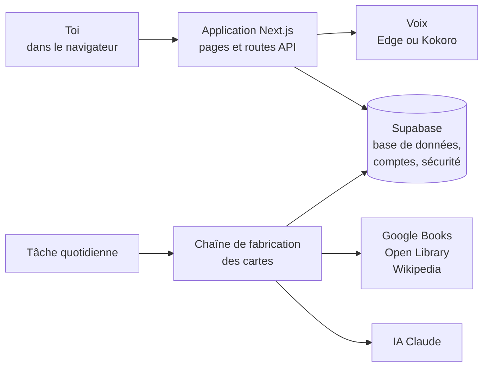

# Stash

**Apprends un petit truc utile chaque jour, en cinq minutes.**

Stash est une application web de microapprentissage. Tu fais défiler des **cartes** : chacune contient une idée courte, tirée de l'esprit des meilleurs livres de développement personnel (psychologie, communication, négociation, discipline, santé, argent…), et surtout **une action concrète à faire aujourd'hui**. Tu sauvegardes ce qui te parle, l'appli te le fait revoir au bon moment, et tu peux même te le faire lire à voix haute.

Les cartes ne copient jamais un livre : ce sont des idées **reformulées**, écrites comme parlerait un ami (on te tutoie, avec des exemples de la vraie vie), et chacune garde sa source pour que tu puisses aller lire l'original.

> 📘 **Envie de comprendre comment le projet a été pensé et construit ?** Tout est expliqué dans la [documentation complète](docs/DOCUMENTATION.md) : architecture, base de données, schémas, méthode de travail, feuille de route.

---

## Ce que tu peux faire dans l'appli

- **Faire défiler un fil de cartes** adapté à tes thèmes, avec 20 % de découvertes hors de tes habitudes.
- **Sauvegarder** une carte et lui ajouter une note personnelle.
- **Réviser** tes cartes sauvegardées avec la répétition espacée (plus tu les connais, plus elles reviennent tard).
- **Relever le défi du jour** : une carte, une action, une case à cocher.
- **Suivre ta série** de jours consécutifs et ta progression par catégorie.
- **Retrouver tout ce que tu as lu** dans l'Historique (filtres, recherche) et le **relire** à ta façon.
- **Écouter** une carte à voix haute, avec la phrase lue qui se surligne.
- **Chercher** dans les cartes, les livres et les catégories.
- Passer en **mode sombre**, lire en **français ou en anglais**, utiliser l'appli sur **téléphone** comme sur ordinateur.
- **Exporter tes données** ou **supprimer ton compte** quand tu veux.

Il y a aussi une page **admin** pour surveiller la fabrication des cartes et relire des cartes au hasard.

---

## Lancer le projet de zéro

Tu as téléchargé le projet depuis GitHub et tu veux le voir tourner sur ton ordinateur ? Voici le chemin le plus court. **Compte 10 à 15 minutes** la première fois (le plus long est le téléchargement de Supabase par Docker).

### Ce qu'il te faut d'abord (une seule fois)

| Outil | À quoi il sert | Où le trouver |
|---|---|---|
| **Node.js** version 20.9 ou plus | Faire tourner l'appli | https://nodejs.org (prends la version « LTS ») |
| **Docker Desktop** | Faire tourner la base de données et la connexion sur ton ordinateur | https://www.docker.com/products/docker-desktop/ |
| **Git** | Télécharger le projet | https://git-scm.com |

Pour vérifier que Node est là, tape `node -v` dans un terminal : il doit afficher `v20.9` ou plus.

> Après avoir installé Docker Desktop, **ouvre-le** et attends qu'il indique qu'il tourne (« Docker Desktop is running »). C'est l'oubli le plus fréquent.

### Les quatre commandes

Ouvre un terminal et tape, l'une après l'autre :

```bash
git clone https://github.com/sami136kwe/deepstatsh.git
```

```bash
cd deepstatsh
```

```bash
npm install
```

```bash
npm run setup
```

La dernière commande fait tout le travail à ta place : elle vérifie que Docker répond, démarre la base de données, crée ton fichier de réglages `.env.local`, et charge les 12 catégories et des cartes d'exemple. Quand elle affiche **« Tout est prêt »**, lance l'appli :

```bash
npm run dev
```

Ouvre **http://localhost:3000** dans ton navigateur, crée un compte (e-mail et mot de passe, aucune confirmation n'est demandée en local), choisis ta langue, tes thèmes et ton objectif du jour. Tu arrives sur ton fil de cartes. C'est tout.

> ⚠️ Utilise bien l'adresse **`localhost:3000`** et pas l'adresse réseau de ton ordinateur (du genre `192.168…`) : dans ce cas, l'appli peut se comporter bizarrement en développement.

### Si ça coince

| Ce que tu vois | Ce qu'il faut faire |
|---|---|
| `Docker ne répond pas` ou `Cannot connect to the Docker daemon` | Ouvre Docker Desktop, attends qu'il indique « running », puis relance `npm run setup`. |
| `port is already allocated` ou `address already in use` (ports 55320 à 55329) | Quelque chose d'autre utilise ces ports. Stash utilise des ports différents de ceux par défaut de Supabase (54321…), donc il peut tourner **à côté d'un autre projet Supabase**. Si un autre Stash tourne déjà, arrête-le (`npx supabase stop` dans son dossier), puis relance. |
| Le port 3000 est déjà pris | Lance `npm run dev -- -p 3001` et ouvre http://localhost:3001. |
| La première fois, ça semble figé | Normal : Docker télécharge plusieurs images. Laisse tourner quelques minutes. |
| `Rate exceeded` pendant le téléchargement | Le service d'images est surchargé. Attends une minute et relance `npm run setup`, il reprend où il en était. |
| Le terminal dit `npm: command not found` | Node.js n'est pas installé (voir le tableau plus haut). |

### Les jours suivants

Docker Desktop doit tourner. Ensuite, dans le dossier du projet :

```bash
npx supabase start
```

```bash
npm run dev
```

Pour tout éteindre en fin de journée :

```bash
npx supabase stop
```

Tes comptes et tes cartes sont conservés d'un jour à l'autre.

### Pour repartir de zéro

Si tu veux effacer toute la base et recommencer comme au premier jour :

```bash
npx supabase db reset
```

```bash
npm run setup
```

---

## Les cartes : démo ou vraie base ?

Après `npm run setup`, tu as **12 cartes d'exemple** écrites à la main (chacune en français et en anglais). Elles suffisent pour tout essayer : fil, sauvegarde, révision, défi, historique, audio.

Pour remplir la base avec des **centaines de cartes**, le projet contient une chaîne de fabrication (découverte de livres, génération par l'IA, contrôles de qualité, de style et de doublons). Elle a besoin d'une **clé API Anthropic** (payante). Une fois la clé ajoutée dans `.env.local` :

```bash
npm run seed -- --category=communication
```

fabrique d'abord une seule catégorie, pour juger le résultat avant de dépenser plus. Sans option, le script traite les 12 catégories. Il reprend là où il s'est arrêté si tu l'interromps, et s'arrête tout seul quand le plafond d'appels (`SEED_MAX_MODEL_CALLS`) est atteint.

> ℹ️ Cette chaîne est testée avec un faux modèle, mais **n'a pas encore été lancée avec le vrai** : le style et le coût réels des cartes sont à vérifier sur un premier petit lot. Le détail est dans la [documentation](docs/DOCUMENTATION.md#5-fabriquer-le-contenu--le-pipeline-dingestion).

---

## Écouter les cartes (voix)

Le bouton **Écouter** fonctionne tout de suite avec les voix en ligne de Microsoft Edge (rien à installer, mais il faut Internet, et la première seconde peut se faire attendre).

Pour une lecture **plus rapide, gratuite et hors ligne**, tu peux installer la voix locale Kokoro (installation unique de quelques minutes, nécessite Python 3) :

```bash
npm run tts:kokoro:setup
```

```bash
npm run tts:kokoro
```

Puis ajoute `KOKORO_URL=http://127.0.0.1:8788` dans `.env.local` et relance `npm run dev`. Les voix « local, rapide » apparaissent et deviennent ton choix par défaut. Les modèles (environ 350 Mo) se téléchargent au premier démarrage.

---

## Les commandes utiles

| Commande | Ce qu'elle fait |
|---|---|
| `npm run setup` | Mise en route complète : base de données, réglages, données de départ |
| `npm run dev` | Lance l'appli pour travailler dessus (http://localhost:3000) |
| `npm run build` puis `npm run start` | Version « de production » |
| `npm run seed:demo` | Recharge les 12 cartes d'exemple |
| `npm run seed` | Fabrique des cartes avec l'IA (clé Anthropic nécessaire) |
| `npm run ingest` | Lance une fois la mise à jour quotidienne du contenu |
| `npm test` | Tests de la logique (rapides) |
| `npm run test:db` | Tests de la base de données et de la sécurité (Supabase doit tourner) |
| `npm run test:e2e` | Tests dans un vrai navigateur (voir ci-dessous) |
| `npm run lint` et `npm run typecheck` | Vérifications de qualité du code |
| `npm run db:types` | Régénère les types après un changement de la base |

---

## Les réglages (`.env.local`)

`npm run setup` crée ce fichier pour toi. Les variables sont toutes expliquées dans [`.env.example`](.env.example). Voici les seules qui comptent au départ :

| Variable | Pour quoi faire |
|---|---|
| `ADMIN_EMAILS` | Ton adresse e-mail, pour avoir accès à la page `/admin` (`npm run setup -- --admin=toi@exemple.com` la renseigne) |
| `ANTHROPIC_API_KEY` | Ta clé, uniquement si tu veux fabriquer des cartes avec l'IA |
| `KOKORO_URL` | Seulement si tu installes la voix locale |

> Les clés Supabase que `npm run setup` écrit sont les **clés locales par défaut**, communes à tout le monde. Elles ne protègent rien et ne doivent jamais servir en production.

---

## Comment c'est fait (en bref)



- **Next.js 16** (React, TypeScript strict) et **Tailwind CSS** pour l'appli.
- **Supabase** (PostgreSQL) pour les données, la connexion e-mail et Google, et la **sécurité au niveau des lignes** : la base elle-même refuse de montrer à quelqu'un les données d'un autre.
- **pgvector** pour repérer les cartes qui disent la même chose.
- **L'API Anthropic (Claude)**, côté serveur seulement, pour fabriquer les cartes.
- **Vitest** et **Playwright** pour les tests.

Les dossiers principaux : `app/` (pages et routes), `components/` (briques d'interface), `lib/` (la logique : ingestion, révision, audio, fil), `supabase/` (base de données : migrations, fonction, données de départ), `scripts/` (mise en route), `tests/`. Chaque dossier est expliqué dans la [documentation](docs/DOCUMENTATION.md#2-vue-densemble-de-larchitecture).

---

## Les tests

```bash
npm test
```

```bash
npm run test:db
```

```bash
npm run test:e2e
```

- `npm test` vérifie la logique pure (révision espacée, règles de style, détection de copie, mélange du fil…).
- `npm run test:db` demande que Supabase tourne (`npx supabase start`) et que les cartes d'exemple soient chargées (`npm run seed:demo`). Il vérifie la sécurité (un utilisateur ne voit pas les données d'un autre), les fonctions de la base et la chaîne de fabrication complète avec un faux modèle.
- `npm run test:e2e` joue de vrais parcours dans un navigateur (inscription, fil, sauvegarde, révision, historique, audio), en version mobile et ordinateur. Il faut avoir lancé `npm run build` avant, et installé le navigateur de test une fois : `npx playwright install chromium`.

Au dernier passage : **62 tests de logique, 23 tests de base de données, 12 tests de navigateur**, tous verts.

---

## Où en est le projet

**Fait et testé :** comptes, onboarding, fil de cartes, sauvegarde et notes, révision espacée, défi du jour, série, progression, recherche, pages livre / carte / catégorie, page admin, export et suppression du compte, cartes bilingues liées, historique, mode Relire, lecture audio, chaîne de fabrication du contenu (avec un faux modèle).

**Pas encore fait :**

- le **paquet du jour** (navigation avant/arrière façon « histoire », limite de 50 cartes ou illimité, jours précédents) ;
- le **bouton FR/EN** dans l'en-tête et sur chaque carte ;
- la **génération complète de la base** (objectif : 10 000 cartes) avec son script `seed:cards`, sa vérification `check:db` et ses exports.

**Jamais essayé en vrai :** la génération avec le vrai modèle, la connexion Google, la mise en ligne sur Vercel.

La feuille de route détaillée, les risques et les décisions sont dans la [documentation](docs/DOCUMENTATION.md#10-gestion-de-projet).

---

## Mettre en ligne

Le projet est prévu pour tourner gratuitement sur **Vercel** (l'appli) et **Supabase** (la base), hors coût de l'API Anthropic. Les étapes (créer le projet Supabase, brancher Google, déployer sur Vercel, activer la tâche quotidienne) sont détaillées dans la [documentation](docs/DOCUMENTATION.md#12-mettre-en-ligne). Cette partie n'a pas encore été testée de bout en bout.

---

## Droits d'auteur et style

- Les cartes sont des **idées reformulées**, jamais des passages copiés. La chaîne de fabrication refuse toute carte qui ressemble trop à la description du livre.
- Une **citation** n'est gardée que si elle fait moins de 15 mots, qu'on la retrouve mot pour mot sur Wikiquote et qu'elle est attribuée. Une seule par livre.
- Chaque carte garde sa **source** : livre, auteur, lien vers Google Books ou Open Library, et un lien « Trouver en bibliothèque ».
- Aucune récupération de pages Google : la découverte de livres passe par les API gratuites **Google Books** et **Open Library**.
- Le style (tutoiement, exemples concrets, phrases de longueurs variées, position assumée, pas de formules de dépliant) est écrit dans `lib/ai/prompts.ts` et **vérifié automatiquement** par `lib/ingestion/style.ts`.
- Santé, psychologie, argent : de l'**information générale** seulement, jamais un conseil médical ou financier personnalisé.

## Stash est maintenant une bibliothèque de livres

Chaque livre contient des **idées numérotées** (par exemple 8). Une idée est une histoire qui défile, suivie de « ce qu'il faut retenir » et d'une action. L'idée suivante se débloque quand tu appuies sur *Continuer*. Navigation : **Accueil, Explorer, Bibliothèque, Profil**. Le premier livre fourni est *The Power of Now* (anglais). Après `git apply`, lance `npx supabase migration up` puis `npm run seed:demo`.
