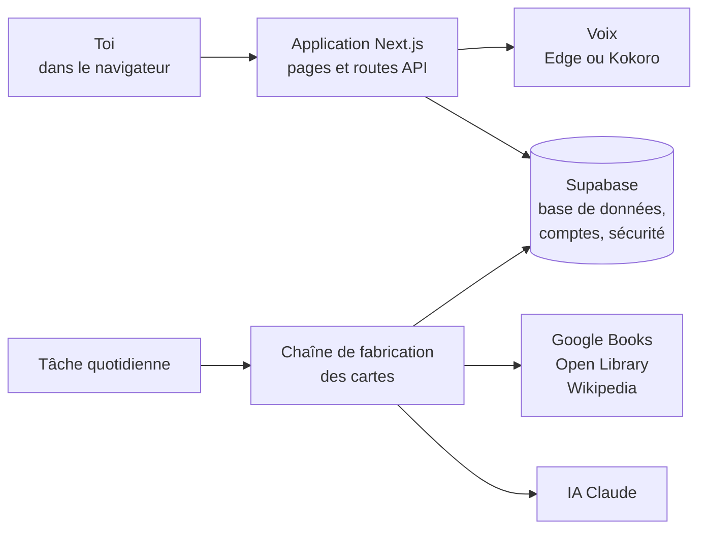

# Stash

**Une bibliothèque de livres à lire en petites idées, en quelques minutes par jour.**

Stash découpe des livres de développement personnel, de business, d'investissement et de relations en **idées numérotées**. Chaque idée se lit en trois temps : **une histoire** qui met en scène le principe, **« ce qu'il faut retenir »**, puis **une action concrète** à faire aujourd'hui. L'idée suivante se débloque quand tu termines la précédente, avec une barre de progression pour tout le livre. Tu peux enregistrer des livres dans ta bibliothèque, revenir là où tu t'étais arrêté, et même te faire lire une idée à voix haute.

Les idées s'inspirent des livres sans jamais les copier : les histoires sont inventées, écrites comme parlerait un ami (on te tutoie), et elles **ne remplacent pas la lecture du livre**.

> 📘 **Envie de comprendre comment le projet a été pensé et construit ?** Tout est expliqué dans la [documentation complète](docs/DOCUMENTATION.md) : architecture, base de données, schémas, méthode de travail, feuille de route.

---

## Ce que tu peux faire dans l'appli

Quatre onglets en bas de l'écran : **Accueil, Explorer, Bibliothèque, Profil**.

- **Accueil** : reprendre ta lecture, livres « selon tes préférences », dernières nouveautés, livres à la une, puis une étagère par thème.
- **Explorer** : chercher un livre par titre ou auteur, parcourir les thèmes (dont **Produit & Business** et **Investissements & Marchés**).
- **Page d'un livre** : couverture, résumé, barre de progression, liste des idées (les suivantes sont verrouillées), bouton **Commencer / Continuer**.
- **Lire une idée** : l'histoire en paragraphes, puis « ce qu'il faut retenir » et « à faire aujourd'hui » dans deux cartes colorées. **Idée suivante** débloque la suite.
- **Bibliothèque** : tes livres **en cours**, **enregistrés** et **terminés**.
- **Profil** : réglages (langue, thèmes), et les autres outils : **stash** (idées sauvegardées avec une note), **révision espacée**, **défi du jour**, **progrès et série de jours**, **historique** et **relecture**.
- **Écouter** une idée à voix haute, avec la phrase lue qui se surligne.
- Passer du **mode sombre** (par défaut) au mode clair, lire en **français ou en anglais**, utiliser l'appli sur **téléphone** comme sur ordinateur.
- **Exporter tes données** ou **supprimer ton compte** quand tu veux.

Il y a aussi une page **admin** pour surveiller la fabrication automatique de contenu.

---

## Lancer le projet de zéro

Tu as téléchargé le projet depuis GitHub et tu veux le voir tourner sur ton ordinateur ? Voici le chemin le plus court. **Compte 10 à 15 minutes** la première fois (le plus long est le téléchargement de Supabase par Docker).

### Ce qu'il te faut d'abord (une seule fois)

| Outil | À quoi il sert | Où le trouver |
|---|---|---|
| **Node.js** version 20.9 ou plus | Faire tourner l'appli | https://nodejs.org (prends la version « LTS ») |
| **Docker Desktop** | Faire tourner la base de données et la connexion sur ton ordinateur | https://www.docker.com/products/docker-desktop/ |
| **Git** | Télécharger le projet | https://git-scm.com |

Pour vérifier que Node est là, tape `node -v` dans un terminal : il doit afficher `v20.9` ou plus.

> Après avoir installé Docker Desktop, **ouvre-le** et attends qu'il indique qu'il tourne (« Docker Desktop is running »). C'est l'oubli le plus fréquent.

### Les quatre commandes

Ouvre un terminal et tape, l'une après l'autre :

```bash
git clone https://github.com/sami136kwe/deepstash.git
```

```bash
cd deepstash
```

```bash
npm install
```

```bash
npm run setup
```

La dernière commande fait tout le travail à ta place : elle vérifie que Docker répond, démarre la base de données, crée ton fichier de réglages `.env.local`, et charge les 14 catégories, les livres et des cartes d'exemple. Quand elle affiche **« Tout est prêt »**, lance l'appli :

```bash
npm run dev
```

Ouvre **http://localhost:3000** dans ton navigateur, crée un compte (e-mail et mot de passe, aucune confirmation n'est demandée en local), choisis ta langue et tes thèmes. Tu arrives sur l'Accueil, avec les livres. C'est tout.

> ⚠️ Utilise bien l'adresse **`localhost:3000`** et pas l'adresse réseau de ton ordinateur (du genre `192.168…`) : dans ce cas, l'appli peut se comporter bizarrement en développement.

### Si ça coince

| Ce que tu vois | Ce qu'il faut faire |
|---|---|
| `Docker ne répond pas` ou `Cannot connect to the Docker daemon` | Ouvre Docker Desktop, attends qu'il indique « running », puis relance `npm run setup`. |
| `port is already allocated` ou `address already in use` (ports 55320 à 55329) | Quelque chose d'autre utilise ces ports. Stash utilise des ports différents de ceux par défaut de Supabase (54321…), donc il peut tourner **à côté d'un autre projet Supabase**. Si un autre Stash tourne déjà, arrête-le (`npx supabase stop` dans son dossier), puis relance. |
| Le port 3000 est déjà pris | Lance `npm run dev -- -p 3001` et ouvre http://localhost:3001. |
| La première fois, ça semble figé | Normal : Docker télécharge plusieurs images. Laisse tourner quelques minutes. |
| `Rate exceeded` pendant le téléchargement | Le service d'images est surchargé. Attends une minute et relance `npm run setup`, il reprend où il en était. |
| Le terminal dit `npm: command not found` | Node.js n'est pas installé (voir le tableau plus haut). |

### Les jours suivants

Docker Desktop doit tourner. Ensuite, dans le dossier du projet :

```bash
npx supabase start
```

```bash
npm run dev
```

Pour tout éteindre en fin de journée :

```bash
npx supabase stop
```

Tes comptes et tes cartes sont conservés d'un jour à l'autre.

### Pour repartir de zéro

Si tu veux effacer toute la base et recommencer comme au premier jour :

```bash
npx supabase db reset
```

```bash
npm run setup
```

---

## Le contenu : 100 livres déjà inclus

Après `npm run setup` (ou `npm run seed:demo`), tu as **100 livres et 602 idées** écrits à la main, répartis dans les thèmes : investissements, business, relations, développement personnel, productivité, santé, créativité. Exemples : *The Power of Now*, *The Psychology of Money*, *Atomic Habits*, *Crucial Conversations*, *The Lean Startup*, *Never Split the Difference*.

À savoir :

- **Les livres sont en anglais pour l'instant.** Si ton interface est en français, tu les vois avec un message « pas encore disponible en français ». Les versions françaises sont à venir.
- *The Power of Now* a des histoires longues (8 idées). Les autres livres ont 6 idées aux histoires plus courtes, qui seront allongées livre par livre.
- Les idées sont écrites **de mémoire**, inspirées des livres : relis-les avant de t'y fier, surtout pour la santé et l'argent.
- Il reste aussi **12 cartes d'exemple** sans livre (en français et en anglais), utilisées par le mode Relire.

### Fabriquer du contenu avec l'IA (optionnel)

Le projet contient aussi une chaîne de fabrication automatique (découverte de livres, génération par l'IA, contrôles de qualité, de style et de doublons). Elle a besoin d'une **clé API Anthropic** (payante) :

```bash
npm run seed -- --category=communication
```

fabrique d'abord une seule catégorie, pour juger le résultat avant de dépenser plus. Elle reprend là où elle s'est arrêtée et s'arrête quand le plafond d'appels (`SEED_MAX_MODEL_CALLS`) est atteint.

> ℹ️ Cette chaîne est testée avec un faux modèle, mais **n'a pas encore été lancée avec le vrai**, et elle ne produit pas encore de livres numérotés comme ceux de la bibliothèque. Le détail est dans la [documentation](docs/DOCUMENTATION.md#5-fabriquer-le-contenu--le-pipeline-dingestion).

---

## Écouter les idées (voix)

Le bouton **Écouter** du lecteur d'idée fonctionne tout de suite avec les voix en ligne de Microsoft Edge (rien à installer, mais il faut Internet, et la première seconde peut se faire attendre).

Pour une lecture **plus rapide, gratuite et hors ligne**, tu peux installer la voix locale Kokoro (installation unique de quelques minutes, nécessite Python 3) :

```bash
npm run tts:kokoro:setup
```

```bash
npm run tts:kokoro
```

Puis ajoute `KOKORO_URL=http://127.0.0.1:8788` dans `.env.local` et relance `npm run dev`. Les voix « local, rapide » apparaissent et deviennent ton choix par défaut. Les modèles (environ 350 Mo) se téléchargent au premier démarrage.

---

## Les commandes utiles

| Commande | Ce qu'elle fait |
|---|---|
| `npm run setup` | Mise en route complète : base de données, réglages, données de départ |
| `npm run dev` | Lance l'appli pour travailler dessus (http://localhost:3000) |
| `npm run build` puis `npm run start` | Version « de production » |
| `npm run seed:demo` | Recharge les 100 livres, leurs idées et les 12 cartes d'exemple |
| `npm run seed` | Fabrique du contenu avec l'IA (clé Anthropic nécessaire) |
| `npm run ingest` | Lance une fois la mise à jour quotidienne du contenu |
| `npm test` | Tests de la logique (rapides) |
| `npm run test:db` | Tests de la base de données et de la sécurité (Supabase doit tourner) |
| `npm run test:e2e` | Tests dans un vrai navigateur (voir ci-dessous) |
| `npm run lint` et `npm run typecheck` | Vérifications de qualité du code |
| `npm run db:types` | Régénère les types après un changement de la base |

---

## Les réglages (`.env.local`)

`npm run setup` crée ce fichier pour toi. Les variables sont toutes expliquées dans [`.env.example`](.env.example). Voici les seules qui comptent au départ :

| Variable | Pour quoi faire |
|---|---|
| `ADMIN_EMAILS` | Ton adresse e-mail, pour avoir accès à la page `/admin` (`npm run setup -- --admin=toi@exemple.com` la renseigne) |
| `ANTHROPIC_API_KEY` | Ta clé, uniquement si tu veux fabriquer des cartes avec l'IA |
| `KOKORO_URL` | Seulement si tu installes la voix locale |

> Les clés Supabase que `npm run setup` écrit sont les **clés locales par défaut**, communes à tout le monde. Elles ne protègent rien et ne doivent jamais servir en production.

---

## Comment c'est fait (en bref)



- **Next.js 16** (React, TypeScript strict) et **Tailwind CSS** pour l'appli.
- **Supabase** (PostgreSQL) pour les données, la connexion e-mail et Google, et la **sécurité au niveau des lignes** : la base elle-même refuse de montrer à quelqu'un les données d'un autre.
- **pgvector** pour repérer les cartes qui disent la même chose.
- **L'API Anthropic (Claude)**, côté serveur seulement, pour fabriquer les cartes.
- **Vitest** et **Playwright** pour les tests.

Les dossiers principaux : `app/` (pages et routes : `home`, `explore`, `library`, `books/[id]`…), `components/` (couvertures, étagères, navigation), `lib/` (la logique : livres, ingestion, révision, audio), `supabase/` (base de données : migrations, fonction, `seed/books/` pour les livres), `scripts/` (mise en route), `tests/`. Chaque dossier est expliqué dans la [documentation](docs/DOCUMENTATION.md#2-vue-densemble-de-larchitecture).

---

## Les tests

```bash
npm test
```

```bash
npm run test:db
```

```bash
npm run test:e2e
```

- `npm test` vérifie la logique pure (révision espacée, règles de style, détection de copie, mélange du fil…).
- `npm run test:db` demande que Supabase tourne (`npx supabase start`) et que les cartes d'exemple soient chargées (`npm run seed:demo`). Il vérifie la sécurité (un utilisateur ne voit pas les données d'un autre), le déblocage des idées dans l'ordre, les fonctions de la base et la chaîne de fabrication complète avec un faux modèle.
- `npm run test:e2e` joue de vrais parcours dans un navigateur (inscription, ouverture d'un livre, lecture des idées dans l'ordre, bibliothèque, recherche, historique, audio), en version mobile et ordinateur. Il faut avoir lancé `npm run build` avant, et installé le navigateur de test une fois : `npx playwright install chromium`.

Au dernier passage : **78 tests de logique, 31 tests de base de données, 10 tests de navigateur**, tous verts. Les tests de logique vérifient aussi que chacune des 602 idées respecte les règles de qualité et de style.

---

## Où en est le projet

**Fait et testé :** comptes, onboarding, bibliothèque de livres (accueil, explorer, thèmes, bibliothèque, page livre), lecteur d'idée avec déblocage dans l'ordre et progression, **100 livres et 602 idées** en anglais, stash et notes, révision espacée, défi du jour, série, historique, mode Relire, lecture audio, export et suppression du compte, page admin, chaîne de fabrication (avec un faux modèle).

**Pas encore fait :**

- les **versions françaises** des livres (aujourd'hui, un lecteur français voit l'anglais, et son stash, son historique et ses relectures ne montrent pas encore ces idées) ;
- des **histoires plus longues** pour les 99 livres autres que *The Power of Now* ;
- de **vraies couvertures** de livres (elles sont générées pour l'instant) ;
- un **onglet actualités** pour Investissements & Marchés (reporté) ;
- la **génération automatique de livres** par l'IA, adaptée aux idées numérotées ;
- le vocabulaire « cartes » encore présent dans l'onboarding.

**Jamais essayé en vrai :** la génération avec le vrai modèle, la connexion Google, la mise en ligne sur Vercel.

La feuille de route détaillée, les risques et les décisions sont dans la [documentation](docs/DOCUMENTATION.md#10-gestion-de-projet).

---

## Mettre en ligne

Le projet est prévu pour tourner gratuitement sur **Vercel** (l'appli) et **Supabase** (la base), hors coût de l'API Anthropic. Les étapes (créer le projet Supabase, brancher Google, déployer sur Vercel, activer la tâche quotidienne) sont détaillées dans la [documentation](docs/DOCUMENTATION.md#12-mettre-en-ligne). Cette partie n'a pas encore été testée de bout en bout.

---

## Droits d'auteur et style

- Les idées sont **inspirées** des livres, avec des personnages et des scènes inventés, jamais des passages copiés. Elles ne remplacent pas la lecture du livre, et l'appli le dit sur chaque page de livre.
- La chaîne de fabrication automatique refuse toute carte qui ressemble trop à la description du livre. Une **citation** n'est gardée que si elle fait moins de 15 mots, qu'on la retrouve mot pour mot sur Wikiquote et qu'elle est attribuée. Une seule par livre.
- Aucune récupération de pages Google : la découverte de livres passe par les API gratuites **Google Books** et **Open Library**.
- Le style (tutoiement, exemples concrets, phrases de longueurs variées, pas de formules de dépliant) est écrit dans `lib/ai/prompts.ts` et **vérifié automatiquement** par `lib/ingestion/style.ts`, y compris pour les livres écrits à la main.
- Santé, psychologie, argent : de l'**information générale** seulement, jamais un conseil médical ou financier personnalisé.
- Si Stash devient public, la question du droit d'auteur et de l'usage des titres de livres récents devra être revue.
