# Stash : documentation complète

Ce document raconte **comment Stash a été pensé, construit et piloté**. Il est écrit pour quelqu'un qui découvre le projet : pas besoin d'être développeur pour suivre les grandes lignes, et les parties techniques sont là pour ceux qui veulent les détails.

Pour simplement **lancer l'application**, lis le [README](../README.md) : cinq minutes suffisent.

## Sommaire

1. [L'idée en deux minutes](#1-lidée-en-deux-minutes)
2. [Vue d'ensemble de l'architecture](#2-vue-densemble-de-larchitecture)
3. [Les données](#3-les-données)
4. [Ce qui se passe quand tu utilises l'app](#4-ce-qui-se-passe-quand-tu-utilises-lapp)
5. [Fabriquer le contenu : le pipeline d'ingestion](#5-fabriquer-le-contenu--le-pipeline-dingestion)
6. [La lecture audio](#6-la-lecture-audio)
7. [Sécurité et vie privée](#7-sécurité-et-vie-privée)
8. [Les grandes décisions, et pourquoi](#8-les-grandes-décisions-et-pourquoi)
9. [Comment le projet a été mené : les prompts](#9-comment-le-projet-a-été-mené--les-prompts)
10. [Gestion de projet](#10-gestion-de-projet)
11. [Qualité : tests et bugs trouvés en route](#11-qualité--tests-et-bugs-trouvés-en-route)
12. [Mettre en ligne](#12-mettre-en-ligne)
13. [Limites connues et risques](#13-limites-connues-et-risques)
14. [Lexique](#14-lexique)

---

## 1. L'idée en deux minutes

**Stash** est une **bibliothèque de livres à lire en petites idées**. Chaque livre est découpé en idées numérotées (6 à 8 en général). Une idée se lit en trois temps : **une histoire** qui met en scène le principe, **« ce qu'il faut retenir »**, puis **une action concrète** à faire aujourd'hui. L'idée suivante se débloque quand tu termines la précédente, et une barre de progression montre où tu en es dans le livre.

Trois principes guident tout le reste :

| Principe | Ce que ça change concrètement |
|---|---|
| **Des idées inspirées des livres, jamais copiées** | Les histoires et les leçons sont écrites avec des mots originaux, avec des personnages inventés. Elles ne remplacent pas la lecture du livre et le disent. |
| **Un style humain** | Tutoiement, scènes de la vie courante, phrases de longueurs variées, pas de formules de dépliant. Des règles automatiques refusent les textes qui sonnent « générés ». |
| **Revenir et lire, pas seulement voir** | Bibliothèque (en cours, enregistrés, terminés), progression livre par livre, révision espacée, défi du jour, série de jours, relecture, lecture audio. |

### Les 14 grandes catégories (les « thèmes »)

**Produit & Business** et **Investissements & Marchés** (les deux thèmes prioritaires) · Psychologie · Communication · Négociation et persuasion · Lecture des gens et langage corporel · Autodiscipline et habitudes · Productivité et gestion du temps · Corps, santé et performance · Mentalité et développement personnel · Leadership et carrière · Relations et vie sociale · Argent et réussite financière · Pensée critique et créativité.

Elles se découpent en sous-catégories (par exemple « Biais cognitifs », « Écoute active », « Sommeil »). Un livre appartient à un ou plusieurs thèmes.

### Le contenu actuel

100 livres et 602 idées, écrits à la main, **en anglais seulement** pour l'instant : *The Power of Now* (8 idées, histoires longues), puis 99 livres de 6 idées (investissements, business, relations, développement personnel, productivité, santé, créativité). Un lecteur dont l'interface est en français voit ces livres avec un message « pas encore disponible en français ». Les versions françaises sont prévues.

### Le parcours d'une personne qui utilise l'app

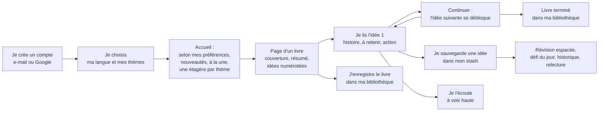

### Les quatre onglets

| Onglet | Contenu |
|---|---|
| **Accueil** | Reprendre la lecture, selon tes préférences, dernières nouveautés, livres à la une, puis une étagère par thème |
| **Explorer** | Recherche par titre ou auteur, tous les thèmes, une étagère par thème, page d'un thème |
| **Bibliothèque** | Trois étagères : en cours, enregistrés, terminés |
| **Profil** | Réglages, et l'accès aux outils : stash, révision, défi, progrès, historique, relecture |

---

## 2. Vue d'ensemble de l'architecture

Stash est une application web composée de trois grands blocs : ce que voit la personne (le navigateur), le serveur de l'application (Next.js) et les services de données (Supabase). À côté, une chaîne de fabrication de contenu s'appuie sur l'IA et sur des catalogues de livres.

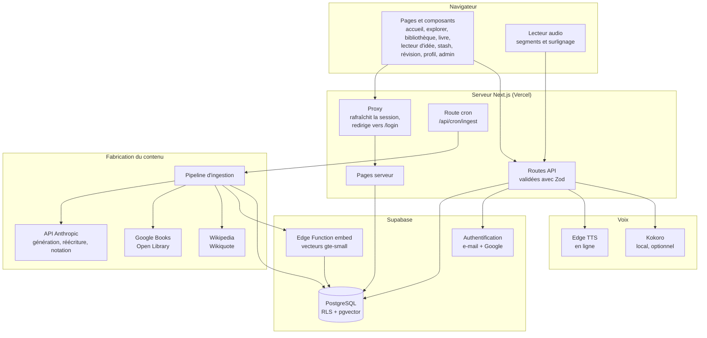

### Les dossiers, en une phrase chacun

```text
app/                 les pages et les routes d'API (home, explore, library, books/[id], books/[id]/ideas/[position]…)
components/          les briques d'interface : couverture, tuile de livre, étagère, navigation à 4 onglets, icônes
lib/
  books.ts           lecture des livres, des idées et de la progression
  books-logic.ts     logique pure : idées débloquées, pourcentage, couleurs de couverture
  supabase/          les trois façons de parler à la base : navigateur, serveur, administrateur
  ingestion/         tout ce qui fabrique et contrôle les cartes
  ai/                les consignes données à Claude
  srs/               la répétition espacée (algorithme SM-2)
  feed/              le mélange des cartes du fil
  tts/               la lecture audio (découpage, lecteur, moteurs de voix)
  i18n/              les textes de l'interface en français et en anglais
supabase/
  migrations/        l'histoire du schéma de la base, fichier par fichier
  functions/embed/   la fonction qui transforme un texte en vecteur
  seed/              les catégories et les cartes de démonstration
scripts/             setup, seed, ingest : les commandes de mise en route
tts-server/          le serveur de voix locale Kokoro (optionnel)
tests/               unit (logique), integration (base de données), e2e (navigateur)
```

### Les technologies

| Besoin | Choix | Pourquoi |
|---|---|---|
| Interface et serveur | Next.js 16 (App Router), React 19, TypeScript strict | Un seul projet pour les pages et l'API, très bien supporté par Vercel. |
| Style | Tailwind CSS 4 | Rapide à écrire, thème clair/sombre simple. |
| Base de données et connexion | Supabase (PostgreSQL, Auth) | Base solide, connexion toute faite, règles de sécurité écrites dans la base elle-même (RLS). |
| Recherche de doublons | pgvector | Comparer le sens de deux cartes directement en SQL. |
| Génération de texte | API Anthropic (Claude), côté serveur uniquement | La clé ne quitte jamais le serveur. |
| Validation | Zod | Chaque entrée (API, réponse de l'IA, variables d'environnement) est vérifiée. |
| Tests | Vitest et Playwright | La logique d'un côté, le parcours réel dans un navigateur de l'autre. |

---

## 3. Les données

### Le schéma en un coup d'œil

Une **idée** est stockée dans la table `cards` (le nom technique est resté, l'interface parle d'« idées »). Elle porte son identité : sa catégorie, son **livre**, son **numéro dans le livre** (`position`), sa difficulté, ses scores. Le **texte** (titre, histoire, ce qu'il faut retenir, action) vit dans les **traductions** (`card_translations`) : une ligne par langue. Un **livre** (`books`) a un résumé par langue (`book_translations`), un ou plusieurs thèmes (`book_topics`) et un indicateur « à la une ».

La progression de lecture est écrite uniquement par des fonctions SQL : `user_books` (livre enregistré, commencé, terminé) et `user_idea_progress` (idées terminées).

```mermaid
erDiagram
    categories ||--o{ categories : "sous-catégories"
    categories ||--o{ cards : "classe"
    books ||--o{ cards : "contient les idées"
    books ||--o{ book_translations : "résumé fr et en"
    books ||--o{ book_topics : "appartient à"
    categories ||--o{ book_topics : ""
    auth_users ||--o{ user_books : "bibliothèque"
    books ||--o{ user_books : ""
    auth_users ||--o{ user_idea_progress : "idées terminées"
    cards ||--o{ user_idea_progress : ""
    cards ||--|{ card_translations : "fr et en"
    auth_users ||--|| profiles : "a un profil"
    auth_users ||--o{ stashes : "sauvegarde"
    cards ||--o{ stashes : ""
    auth_users ||--o{ card_reviews : "révise"
    cards ||--o{ card_reviews : ""
    auth_users ||--o{ card_views : "journal de lecture"
    cards ||--o{ card_views : ""
    auth_users ||--o{ user_card_state : "historique"
    cards ||--o{ user_card_state : ""
    auth_users ||--o{ daily_deck : "paquet du jour"
    cards ||--o{ daily_deck : ""
    ingestion_runs ||--o{ cards : "a produit"
    categories ||--o{ ingestion_queries : "requêtes de découverte"

    categories {
        uuid id PK
        text slug
        text name_fr
        text name_en
        uuid parent_id FK
    }
    books {
        uuid id PK
        text title
        text author
        text slug
        boolean is_featured
        boolean is_public_domain
        numeric popularity_score
    }
    book_translations {
        uuid book_id PK
        text language PK
        text summary
    }
    book_topics {
        uuid book_id PK
        uuid category_id PK
    }
    user_books {
        uuid user_id PK
        uuid book_id PK
        boolean is_saved
        timestamptz started_at
        timestamptz completed_at
    }
    user_idea_progress {
        uuid user_id PK
        uuid card_id PK
        uuid book_id FK
        timestamptz completed_at
    }
    cards {
        uuid id PK
        uuid category_id FK
        uuid book_id FK
        int position
        int difficulty
        text status
        numeric quality_score
    }
    card_translations {
        uuid id PK
        uuid card_id FK
        text language
        text title
        text body
        text action_step
        numeric style_score
        text status
        vector embedding
    }
    profiles {
        uuid id PK
        text language
        uuid_array interests
        int daily_goal
        int streak_count
        text daily_limit
        boolean include_reread
    }
    stashes {
        uuid user_id PK
        uuid card_id PK
        text note
    }
    card_reviews {
        uuid user_id PK
        uuid card_id PK
        timestamptz next_review_at
        int interval_days
        numeric ease_factor
    }
    card_views {
        bigint id PK
        uuid user_id FK
        uuid card_id FK
        text action
    }
    user_card_state {
        uuid user_id PK
        uuid card_id PK
        int read_count
        boolean is_stashed
    }
    daily_deck {
        uuid user_id PK
        date deck_date PK
        int position PK
        uuid card_id FK
    }
    ingestion_runs {
        uuid id PK
        text status
        int cards_created
        int cards_rejected
    }
    ingestion_queries {
        uuid id PK
        uuid category_id FK
        text query_text
    }
```

Deux tables ne sont pas dessinées pour garder le schéma lisible : `daily_deck_state` (la position courante dans le paquet du jour) et `profiles.timezone`. Elles sont prêtes dans la base, mais l'écran « paquet du jour » n'est pas encore construit (voir [la feuille de route](#10-gestion-de-projet)).

### Le cycle de vie d'une idée

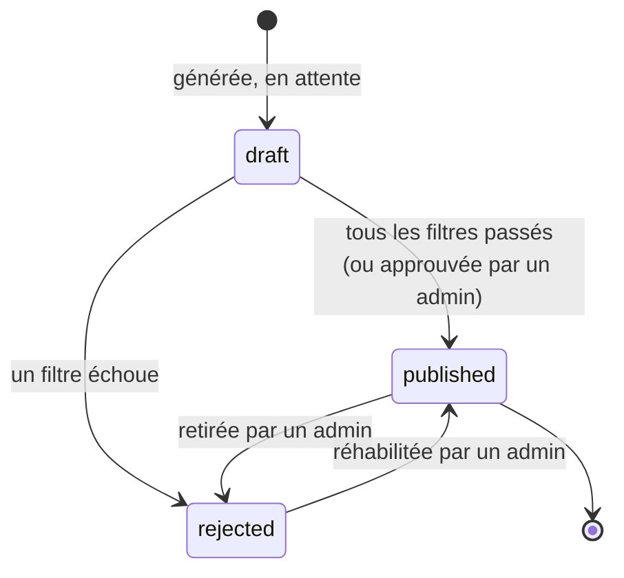

Les idées rejetées ne sont pas supprimées : on garde le **motif** (par exemple « phrase interdite », « trop proche d'une carte existante »). C'est utile pour comprendre ce qui coince et ajuster les règles.

### Le format d'une idée : une histoire, puis une leçon

Une idée se lit dans cet ordre :

1. **Le titre.**
2. **L'histoire** (`story`) : une scène avec un personnage inventé, un lieu et un moment précis (par exemple Priya sur le quai d'une gare, qui rejoue une dispute dans sa tête). Elle montre l'idée sans la nommer ni conclure par une morale. À l'écran, elle s'affiche en **paragraphes de deux phrases**, sans boîtes ni couleurs, pour se lire comme une narration.
3. **Ce qu'il faut retenir** (`body`) : la leçon en 1 à 3 phrases, qui parle à « tu ». Carte sombre arrondie.
4. **L'action** (`action_step`) : une chose concrète à faire aujourd'hui. Carte ambrée.

Limites des règles automatiques (`lib/ingestion/quality.ts`) : l'histoire fait de 3 à 12 phrases, jusqu'à 200 mots et 1200 caractères (la base accepte 1200 caractères). Ces limites ont été relevées après un retour : à 120 mots, les histoires devaient être trop compactées pour rester claires. La monotonie du rythme est mesurée sur l'histoire seule et sur toute l'idée. Dans une histoire, un prénom ou un pronom peut revenir deux fois en début de phrase, pas trois.

### Le déblocage séquentiel

Une idée ne peut être terminée que si **toutes les idées précédentes du même livre le sont**. C'est la base qui l'impose (fonction `complete_idea`), pas seulement l'interface : essayer de contourner renvoie une erreur « idea is locked ». Terminer une nouvelle idée compte pour la série de jours ; terminer une idée déjà faite, non. Ouvrir une idée par l'adresse directe alors qu'elle est verrouillée renvoie vers la page du livre.

### Pourquoi une table de traductions ?

Au départ, chaque langue était une carte séparée. Mais l'idée, elle, est la même : si on veut apprendre le vocabulaire en retournant la carte dans l'autre langue, il faut que ce soit **la même carte**. D'où la séparation : l'identité de l'idée d'un côté, ses deux textes de l'autre. La vue SQL `card_details` recolle le tout : une ligne par carte et par langue, ce qui a permis de ne presque rien changer dans le reste du code.

### Les fonctions SQL importantes

| Fonction | Rôle |
|---|---|
| `complete_idea` | Termine une idée si les précédentes sont faites, met à jour le livre (commencé, terminé), renvoie la progression. |
| `touch_book` | Marque un livre comme commencé et mémorise la dernière ouverture. |
| `set_book_saved` | Ajoute un livre à la bibliothèque ou le retire, sans le commencer. |
| `feed_candidates` | Propose des cartes jamais vues, classées par qualité, style, popularité et un peu de hasard. |
| `daily_challenge` | Choisit la carte du défi du jour, la même toute la journée pour une personne donnée. |
| `record_activity` | Met à jour la série de jours avec la date locale de la personne. |
| `category_progress` | Compte, par catégorie, les cartes vues, sauvegardées et réussies. |
| `history_cards` | Liste l'historique avec filtres, recherche plein texte et pagination. |
| `reread_candidates` | Choisit les cartes à relire (au hasard, plus anciennes, moins relues, sauvegardées). |
| `match_cards` | Trouve les cartes au sens trop proche (déduplication). |

---

## 4. Ce qui se passe quand tu utilises l'app

### Lire un livre

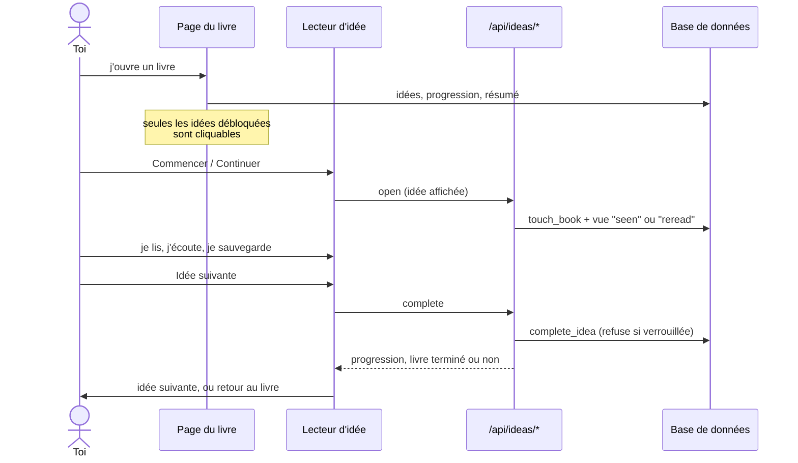

Les étagères de l'accueil et d'Explorer viennent de `lib/books.ts` : un livre n'apparaît que s'il a au moins une idée publiée, dans ta langue si possible, sinon dans l'autre langue avec un message. La recherche d'Explorer interroge directement la base (titre ou auteur).

### L'ancien fil de cartes

L'ancien fil (cartes sans livre) n'est plus la page d'accueil : `/feed` redirige vers `/home`. Son moteur reste utilisé par le mode **Relire**, et les douze cartes d'exemple sans livre sont toujours dans la base. Voici comment il fonctionnait :

### Le fil de cartes

Quand tu ouvres le fil, le navigateur demande dix cartes. Le serveur ne se contente pas de piocher au hasard :

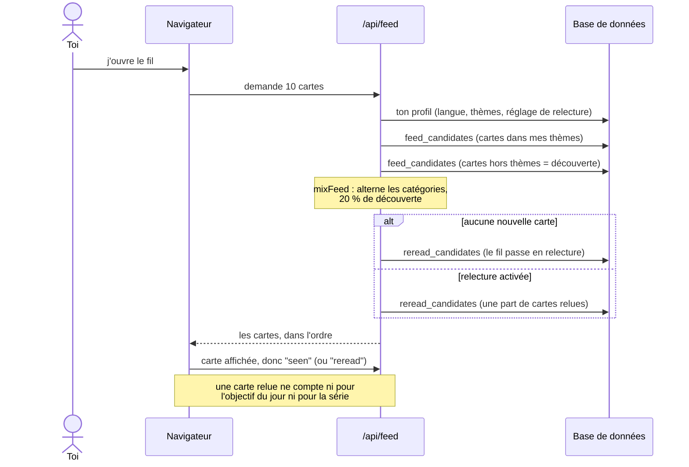

**Le classement** d'une carte nouvelle combine : sa note de qualité (50 %), sa note de style (30 %), sa popularité auprès des autres (logarithme du nombre de sauvegardes) et un peu de hasard pour varier. Les cartes déjà vues ou sauvegardées sont exclues.

**Le mélange** prend ces cartes classées et les répartit **en tournant entre les catégories** (jamais dix cartes de suite sur le même thème), puis glisse environ 20 % de cartes **hors de tes thèmes** pour que tu découvres autre chose.

### La série de jours (streak)

La série compte les jours consécutifs où tu as fait quelque chose d'utile (lire une nouvelle carte, sauvegarder, réviser, faire le défi). Le navigateur envoie **sa date locale**, et la base accepte seulement une date à un jour près de la sienne. Relire des cartes ne compte volontairement pas : c'est un bonus, pas un moyen de gonfler sa série.

### La révision espacée

Quand tu sauvegardes une carte, elle entre dans la file de révision. L'algorithme **SM-2** décide quand elle revient, selon ce que tu réponds :

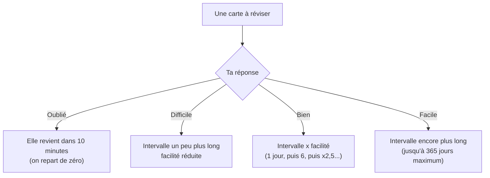

Le bouton **« Revoir plus tard »**, sur une carte déjà lue, la remet dans cette file, due tout de suite.

### Historique et relecture

Chaque carte vue est notée dans `user_card_state` par des **déclencheurs de base de données** : première lecture, dernière lecture, nombre de lectures, sauvegardée ou non. Une carte seulement sauvegardée (par exemple depuis un lien partagé) compte zéro lecture : sa première vraie lecture ne sera pas comptée en double.

La page **Historique** permet de filtrer (catégorie, sous-catégorie, sauvegardées, dates) et de chercher du texte. Le mode **Relire** propose quatre ordres : au hasard, les plus anciennes d'abord, les moins relues d'abord, seulement les sauvegardées.

---

## 5. Fabriquer le contenu : le pipeline d'ingestion

C'est la partie qui remplit la base de cartes, et qui doit le faire **sans copier de livre, sans doublons et avec un style humain**. Elle tourne tous les jours en tâche planifiée, et peut aussi se lancer à la main.

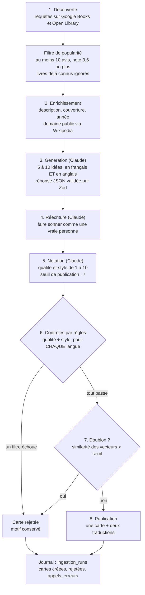

### Les garde-fous

**Droits d'auteur.** Le prompt interdit de recopier. En plus, les règles refusent toute carte qui partage une trop longue suite de mots avec la description du livre. Une citation n'est gardée que si elle fait moins de 15 mots **et** qu'on la retrouve mot pour mot sur Wikiquote ; au plus une par livre. Le statut « domaine public » est volontairement prudent : publié il y a plus de 95 ans **et** auteur mort depuis plus de 70 ans.

**Style humain.** Des règles sans IA refusent : les expressions interdites (« Il est important de noter », « En effet », « crucial », « paradigme »…), les phrases toutes de la même longueur, plus de deux phrases qui commencent par le même mot, les listes de trois adjectifs, les tirets longs en série, une première phrase qui reformule le titre, l'absence de tutoiement, et une structure identique à plus de 30 % des cartes récentes de la catégorie. Ces règles ont déjà attrapé un défaut dans l'une des cartes écrites à la main pour la démo.

**Doublons.** D'abord une empreinte exacte du texte, puis la comparaison du **sens** : chaque texte devient un vecteur de 384 nombres (modèle `gte-small`, calculé gratuitement dans une Edge Function Supabase), et pgvector compare les vecteurs. Une carte trop proche d'une carte existante, **dans la même langue**, est rejetée.

**Coût et robustesse.** Un plafond d'appels au modèle par exécution, un budget de temps, trois tentatives maximum par livre, des pauses entre les appels, et un « backoff exponentiel » (on attend de plus en plus longtemps après chaque échec). Si une étape plante, le travail déjà fait est conservé.

### Comment on l'a testé sans dépenser un centime

Le pipeline complet est testé avec un **faux modèle** et de **fausses API de livres** : on vérifie qu'une bonne carte est publiée dans les deux langues, qu'une mauvaise est rejetée avec ses motifs, qu'un doublon est refusé, que le plafond d'appels arrête proprement l'exécution, et que tout est journalisé. En revanche, **le pipeline n'a jamais tourné avec le vrai modèle Claude** : la qualité réelle des cartes n'est donc pas encore connue.

---

## 6. La lecture audio

Chaque carte peut être lue à voix haute. L'enjeu : **démarrer vite et ne jamais avoir de silence** entre deux morceaux.

### Le principe

Une carte est découpée en **2 à 4 segments**. Le premier est court (pour démarrer vite). Pendant qu'un segment joue, les suivants, et le début de la carte d'après, sont déjà demandés. La phrase en cours de lecture est surlignée, d'après la position dans le son.

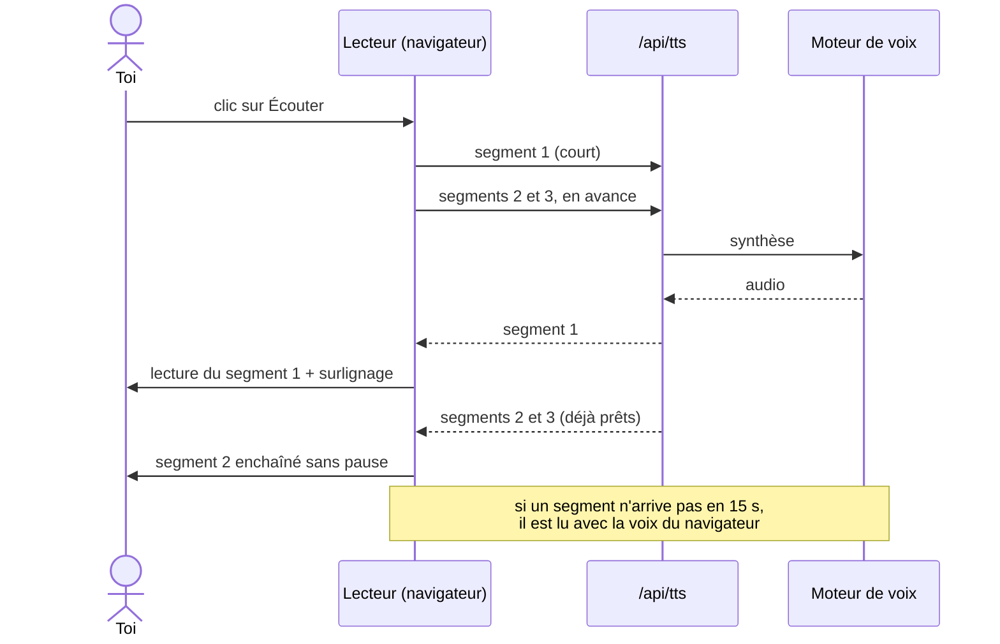

### Deux moteurs de voix

| Moteur | Avantages | Inconvénients |
|---|---|---|
| **Edge TTS** (par défaut) | Rien à installer, voix neuronales Microsoft naturelles | Besoin d'Internet, service non officiel (Microsoft peut le changer ou le bloquer), 1 à 3 secondes par segment |
| **Kokoro** (optionnel, local) | Gratuit, hors ligne, rapide, aucune dépendance externe | Une installation Python à faire, une seule voix française, ne fonctionne pas sur Vercel |

Quand le serveur Kokoro répond, ses voix apparaissent dans le sélecteur et deviennent le choix par défaut.

### D'où vient cette conception ?

Une première version envoyait **une requête par phrase** : chaque petite unité (le titre, « À faire aujourd'hui », chaque phrase) ouvrait sa propre connexion. Les unités courtes se jouaient plus vite qu'elles ne se généraient, d'où des trous de plusieurs secondes. En voyant le code d'un autre projet (un lecteur de PDF) qui utilisait Kokoro en local, il est devenu clair qu'il fallait **moins de requêtes, plus grosses, préchargées**, et un moteur local en option. Cette explication est une déduction à partir du code : la latence réelle d'Edge sur une connexion donnée n'a pas pu être mesurée pendant le développement.

Pour mesurer soi-même, la réponse de `POST /api/tts` contient un en-tête `Server-Timing` (visible dans l'onglet Réseau du navigateur) et le terminal affiche une ligne `[tts] ...`.

---

## 7. Sécurité et vie privée

### Les règles sont dans la base, pas seulement dans le code

Toutes les tables ont la **sécurité au niveau des lignes (RLS)** activée : même si une page oubliait de vérifier qui tu es, la base refuserait de te montrer les données d'un autre.

| Table | Qui peut lire | Qui peut écrire |
|---|---|---|
| `categories`, `books` | tout le monde | personne côté application (service uniquement) |
| `cards`, `card_translations` | tout le monde, mais **seulement les cartes publiées** | personne côté application (service uniquement) |
| `profiles` | toi seul | toi seul, et **pas** les colonnes de série (modifiées uniquement par `record_activity`) |
| `stashes`, `card_reviews`, `daily_deck…` | toi seul | toi seul |
| `card_views` | toi seul | toi seul, ajout uniquement (journal) |
| `user_card_state` | toi seul | personne : uniquement les déclencheurs de la base |
| `ingestion_runs`, `ingestion_queries` | personne côté application | service uniquement |

Ces règles sont **testées** : un test crée deux utilisateurs et vérifie que l'un ne voit rien de l'autre, qu'on ne peut pas modifier une carte, ni forger l'historique d'un autre, ni tricher sur sa série.

### Les secrets

- La clé de l'API Anthropic et la clé « service » de Supabase ne sont lues que **côté serveur**. Seules les variables préfixées `NEXT_PUBLIC_` arrivent dans le navigateur.
- Toutes les routes API valident leurs entrées avec Zod.
- La route de la tâche planifiée exige un secret (`CRON_SECRET`), comparé de manière sûre.
- La page admin est réservée aux adresses listées dans `ADMIN_EMAILS`.
- La route audio exige d'être connecté (elle consomme du temps de calcul) et n'accepte que les voix d'une liste.

### Respect des données personnelles

L'utilisateur peut **exporter** toutes ses données en JSON et **supprimer son compte** : tout ce qui le concerne est supprimé en cascade.

### Un défaut corrigé en route

En développement, ouvrir l'app par l'adresse réseau de l'ordinateur (et non `localhost`) bloquait le JavaScript. Le formulaire de connexion partait alors comme un formulaire HTML classique, **avec l'e-mail et le mot de passe dans l'adresse de la page**. Le formulaire est maintenant forcé en `POST`, ce qui empêche cette fuite même sans JavaScript.

---

## 8. Les grandes décisions, et pourquoi

Chaque fois qu'il y avait plusieurs bonnes options, la plus simple a été choisie, avec la raison.

| Décision | Pourquoi |
|---|---|
| **Pages rendues à la demande** (pas de cache de pages) | Presque tout est personnel (fil, historique, révision) : mettre en cache n'apporterait que de la complexité. |
| **Règles de sécurité dans la base (RLS)** | Une seule source de vérité, testable, qui protège même en cas d'oubli dans le code. |
| **Une carte = une idée + deux traductions** | Permet de retourner une carte dans l'autre langue et d'avoir le même sens et la même action dans les deux. |
| **Vecteurs calculés par une Edge Function Supabase** | Le modèle `gte-small` est intégré et gratuit : pas de service supplémentaire à payer. |
| **Relire est une action à part (`reread`)** | Pour ne jamais fausser l'objectif du jour ni la série. |
| **Lecture audio en segments, avec préchargement** | Moins de requêtes, pas de silence. Voir [section 6](#6-la-lecture-audio). |
| **Edge par défaut, Kokoro en option** | L'app marche partout sans installation, et devient rapide si on installe la voix locale. |
| **Textes d'interface dans nos propres dictionnaires fr/en** | Complets et typés ; ajouter une bibliothèque de plus n'apportait rien pour deux langues. |
| **Les cartes rejetées sont conservées avec leur motif** | On peut comprendre pourquoi, et ajuster les règles. |
| **Un seul script de mise en route (`npm run setup`)** | Quelqu'un qui télécharge le projet doit pouvoir le lancer sans lire dix pages. |

---

## 9. Comment le projet a été mené : les prompts

Stash a été construit **avec un assistant IA (Claude Code)**, en pilotant le travail par des *prompts* : des consignes écrites. Cette section explique la méthode, parce que c'est elle qui a fait avancer le projet vite et dans le bon sens.

### La méthode en une image

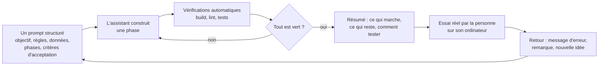

### Les prompts, dans l'ordre

| # | Le prompt | Ce qu'il demandait | Ce qui en est sorti |
|---|---|---|---|
| 1 | **Le prompt fondateur** : « application web de memo cards pour s'améliorer » | Un produit complet en 10 sections : objectif, stack, règles de droits d'auteur, règles de style humain, modèle de données, 12 catégories et 67 sous-catégories, pipeline d'ingestion, fonctionnalités, qualité, plan en 6 phases, critères d'acceptation | L'application complète : base, sécurité, comptes, fil, stash, révision, défi, série, recherche, admin, pipeline, tests |
| 2 | **L'audio** : « lire les cartes à voix haute avec les librairies Edge » | Une lecture vocale avec des voix naturelles | D'abord une version avec la voix du navigateur, puis, après le détail de l'architecture donné par la personne (découpage, préchargement, repli), une version `edge-tts` côté serveur |
| 3 | **Des retours de terminal** (Docker éteint, navigateur Playwright manquant, erreurs de la console) | Débloquer l'installation sur un vrai Mac | Un guide pas à pas, puis le script `npm run setup` |
| 4 | **Le prompt « 10 000 cartes »** : base de contenu + relecture + bilingue + paquet du jour | Générer 10 000 cartes, relire les cartes déjà lues, version fr/en de chaque carte, paquet du jour navigable | Découpé en 5 phases. Les phases 1 (données) et 2 (relecture) sont faites. Voir [la feuille de route](#10-gestion-de-projet) |
| 5 | **La plainte sur l'audio** : « le chargement est beaucoup trop long » + le code d'un autre projet | Corriger la lenteur, en s'inspirant d'un projet qui marchait | Lecture en segments, préchargement, serveur Kokoro local en option |
| 6 | **Cette documentation** | Expliquer le projet, le lancer simplement, documenter conception et gestion | Ce fichier et le README |
| 7 | **Le format histoire** : « chaque idée est racontée comme une petite histoire », avec des captures d'écran d'une autre application comme référence d'interface | Une histoire d'abord (un personnage, une scène), puis ce qu'il faut retenir, puis l'action ; une barre du bas, une bibliothèque, des parcours | Le format de carte en trois temps (voir [la section 3](#le-format-dune-carte--une-histoire-puis-une-leçon)). La suite de l'interface est planifiée, voir [la feuille de route](#10-gestion-de-projet) |

Les prompts suivants ont fait évoluer le produit :

| # | Le prompt | Ce qu'il demandait | Ce qui en est sorti |
|---|---|---|---|
| 8 | **Plusieurs projets côte à côte** (retours de terminal) | Faire tourner Stash à côté d'un autre projet Supabase déjà lancé | Les ports de Stash passent à 55320-55329 pour éviter tout conflit |
| 9 | **Le virage « bibliothèque de livres »** : « enlever l'idée de cartes », des livres avec des idées numérotées, Accueil / Explorer / Bibliothèque / Profil, captures d'écran de référence | Une interface qui donne envie de revenir lire, avec des étagères, des thèmes et un premier livre complet | Nouveau modèle de données (livres, idées, progression), nouvelle navigation, thème sombre, page livre, lecteur d'idée, tests réécrits |
| 10 | **Retours de design** : couvertures plus grandes, sections par catégorie | De vrais rectangles verticaux avec le titre, et des étagères par thème | Couvertures générées (titre, auteur, dos de livre), une étagère par thème sur l'accueil et dans Explorer |
| 11 | **Retour d'erreur** : 404 sur « Commencer » (journal du serveur collé) | Comprendre pourquoi le lien pointait vers `/ideas/undefined` | Le numéro de l'idée est lu directement dans la table `cards`, et une idée introuvable renvoie vers le livre |
| 12 | **Histoires en petits blocs, puis 50 livres** | Rendre l'histoire plus facile à lire, puis écrire 50 livres de plus | Livres écrits à la main avec des règles de qualité vérifiées automatiquement |
| 13 | **Retour sur la mise en page** : « je n'aime pas la séparation », histoires plus longues et plus contextualisées | Une narration fluide, sans boîtes, puis 50 livres de plus | Paragraphes de deux phrases sans fond, 100 livres au total |
| 14 | **Cartes colorées pour la leçon et l'action**, sans limite de longueur | Garder l'histoire noire et remettre en couleur « ce qu'il faut retenir » et « à faire aujourd'hui » ; ne plus compacter les histoires | Cartes colorées, limites de longueur relevées, histoires de *The Power of Now* réécrites (120 à 145 mots) |
| 15 | **Mise à jour du README et de cette documentation** | Refléter le produit actuel | Ce document |

### Ce qui rendait les prompts efficaces

En relisant les prompts, voici ce qui a bien marché, et qu'il vaut la peine de reproduire :

1. **Un objectif clair et des chiffres.** « 100 cartes par catégorie », « seuil de publication : 7 », « moins de 15 mots » : on peut vérifier si c'est fait.
2. **Les règles écrites noir sur blanc.** Le tableau « style IA à éviter / style humain à viser » a été transformé presque tel quel en règles automatiques et en consignes pour le modèle.
3. **Un exemple mauvais et un exemple bon.** Ils servent à la fois de consigne et de test (les deux exemples du prompt sont dans les tests).
4. **Un découpage en phases avec des critères d'acceptation.** Chaque phase se termine par un résumé et des commandes pour vérifier.
5. **Des contraintes d'architecture.** « Aucune clé secrète côté client », « RLS partout », « pas de TODO » évitent des erreurs coûteuses.
6. **Des retours concrets.** Coller la sortie du terminal permet de trouver la cause en une étape plutôt que de deviner.
7. **Du code existant comme référence.** Montrer un projet qui marche a permis de comprendre en quelques minutes pourquoi la première version de l'audio était lente.

### Les moments où il a fallu corriger le tir

Piloter par prompts ne veut pas dire tout accepter sans vérifier. Quelques moments où l'assistant a **signalé un écart plutôt que de l'exécuter tel quel** :

- Le prompt « 10 000 cartes » disait que le style avait déjà été validé sur un échantillon et demandait de lancer sans essai. **Aucune carte réelle n'avait jamais été générée** : l'affirmation était fausse, et le prompt demandait lui-même, plus loin, d'afficher le coût et de demander confirmation. Le script gardera donc la confirmation et le plafond `MAX_BUDGET_USD`.
- Le prompt demandait plus de 8 mots consécutifs copiés comme limite, et 0,90 de similarité, alors que l'application était réglée sur 15 mots et 0,92. L'écart est noté dans la feuille de route plutôt qu'ignoré.
- Les cartes de démonstration sont écrites à la main et marquées `manual` dans la base, pour ne jamais les confondre avec du contenu généré.

---

## 10. Gestion de projet

### La méthode

- **Travail par phases courtes**, chacune livrée avec un résumé : ce qui marche, ce qui reste, comment tester.
- **Définition de « terminé »** : le build passe sans avertissement, le lint est propre, tous les tests passent (unitaires, base de données, navigateur). Une fonctionnalité sans test n'est pas terminée.
- **Les bugs trouvés par les tests sont corrigés avant de passer à la suite**, et le test reste en place pour qu'ils ne reviennent pas.
- **Livraison par correctifs (patchs)** : chaque phase est un fichier `.patch` qui s'applique sur le dossier de la personne, avec les commandes pour l'appliquer et vérifier.
- **Les écarts sont signalés, pas cachés** : ce qui n'a pas pu être testé (par exemple Edge TTS, le déploiement) est dit clairement.

### Feuille de route

```mermaid
flowchart LR
    P0["Application complète<br/>6 phases du prompt fondateur"]:::done --> P1["Audio Edge puis rapide<br/>segments, Kokoro local"]:::done
    P1 --> P2["Données bilingues,<br/>historique, relecture"]:::done
    P2 --> P3["Format histoire"]:::done
    P3 --> P4["Bibliothèque de livres<br/>idées numérotées, déblocage,<br/>4 onglets, 100 livres"]:::done
    P4 --> P5["Histoires plus longues<br/>pour les 99 autres livres"]:::todo
    P5 --> P6["Versions françaises<br/>des livres"]:::todo
    P6 --> P7["Génération automatique<br/>de livres par l'IA"]:::todo

    classDef done fill:#d1fae5,stroke:#047857,color:#064e3b
    classDef todo fill:#fef3c7,stroke:#b45309,color:#78350f
```

### État détaillé

| Chantier | État | Remarque |
|---|---|---|
| Base de données, sécurité (RLS), catégories (14) | ✅ fait | 6 migrations, testé |
| Comptes (e-mail), onboarding, profil, export, suppression | ✅ fait | Connexion Google configurée mais **non testée** |
| **Bibliothèque de livres** : accueil, explorer, thèmes, bibliothèque, page livre | ✅ fait | Étagères par thème, recherche, couvertures générées |
| **Lecteur d'idée** (histoire, à retenir, action), déblocage séquentiel, barre de progression | ✅ fait | Le déblocage est imposé par la base |
| Histoire en paragraphes sans boîtes, leçon et action en cartes colorées | ✅ fait | |
| **100 livres, 602 idées** (anglais) | ✅ fait | Écrits à la main, relecture humaine conseillée |
| Histoires longues (120 à 145 mots) | 🟡 partiel | Seulement *The Power of Now* ; les 99 autres livres ont des histoires d'environ 50 mots |
| Versions françaises des livres | ⏳ à faire | Aujourd'hui, un lecteur français voit l'anglais avec un message. Son stash, son historique et ses relectures ne montrent pas encore ces idées |
| Onboarding : vocabulaire « cartes » | ⏳ à faire | Les écrans parlent encore de « cartes » et d'objectif quotidien |
| Révision espacée, défi du jour, série, progression, historique, mode Relire | ✅ fait | Accessibles depuis le Profil |
| Lecture audio (Edge + Kokoro) | ✅ fait | Sur le lecteur d'idée aussi ; latence Edge réelle non mesurée |
| Pipeline d'ingestion et seed | ✅ fait, testé avec un faux modèle | **Jamais lancé avec le vrai modèle** ; il ne produit pas encore de livres numérotés |
| Onglet actualités (Investissements & Marchés) | ⏸️ reporté | Décision : pas d'actualités pour l'instant |
| Paquet du jour, bouton FR/EN, génération de 10 000 cartes | ⏸️ remplacés | Le virage « livres » les a remplacés ; à replanifier si besoin |
| Vraies couvertures de livres | ⏳ à faire | Le code accepte déjà une URL de couverture par livre |
| Mise en ligne (Vercel + Supabase hébergé) | ⏳ non testée | Voir [section 12](#12-mettre-en-ligne) |

### Dépendances entre les chantiers restants

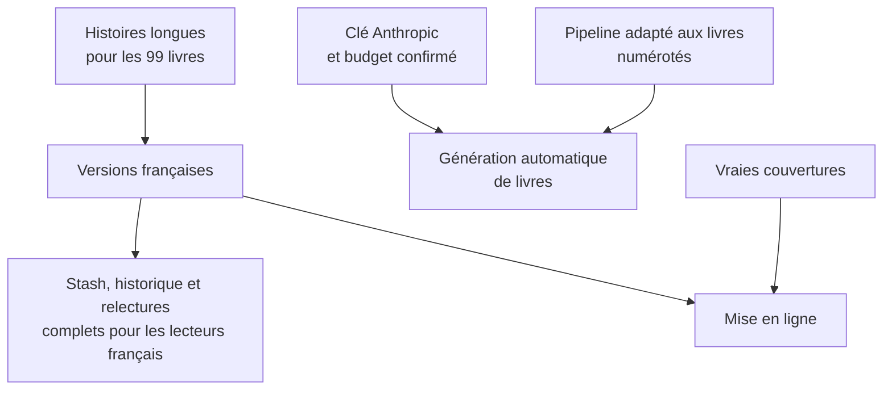

### Les risques, et comment on les gère

| Risque | Gravité | Comment on le gère |
|---|---|---|
| **Le vrai contenu n'a jamais été généré** : qualité et coût inconnus | Haute | Confirmation du coût avant de lancer, plafond d'appels, relecture d'un échantillon de 20 cartes dans `/admin`, mode « brouillon » (`INGEST_PUBLISH_MODE=review`) |
| **Edge TTS est un service non officiel** | Moyenne | Kokoro en alternative locale, repli sur la voix du navigateur |
| **Droits d'auteur** | Haute si négligé | Reformulation imposée, détection de copie, citations vérifiées sur Wikiquote, une par livre, domaine public déterminé prudemment |
| **Conseils de santé ou d'argent** | Moyenne | Consignes « informatif seulement » dans le prompt ; la relecture humaine reste utile |
| **Dépendre d'un modèle d'IA qui change** | Moyenne | Le nom du modèle est un réglage (`ANTHROPIC_MODEL`), les réponses sont validées par Zod |
| **Coût de l'API** | Moyenne | Plafonds configurables, traitement par lots, cache |
| **Données personnelles** | Moyenne | RLS testée, export et suppression du compte |

---

## 11. Qualité : tests et bugs trouvés en route

### Trois niveaux de tests

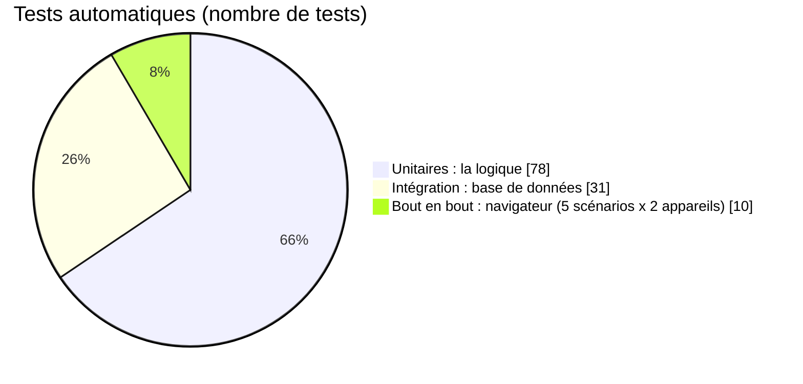

| Niveau | Outil | Ce qu'il vérifie |
|---|---|---|
| **Unitaires** | Vitest | SM-2, mélange du fil, règles de qualité et de style, similarité, découverte de livres, découpage audio, cache |
| **Intégration** | Vitest + vraie base locale | Sécurité (RLS), fonctions SQL, déclencheurs de l'historique, déblocage des idées et progression, pipeline complet avec faux modèle |
| **Bout en bout** | Playwright, mobile et ordinateur | Inscription, accueil, ouverture d'un livre, lecture des idées dans l'ordre, idée verrouillée, bibliothèque, recherche, terminer un livre entier, historique, relecture, lecture audio avec un faux serveur de voix |

Commandes : `npm test`, `npm run test:db`, `npm run test:e2e` (voir le README).

### Ce que les tests ont attrapé

C'est la meilleure preuve que les tests servent. Chaque ligne est un vrai défaut trouvé **avant** que l'utilisateur ne le rencontre :

| Défaut | Découvert par |
|---|---|
| Une carte de démonstration répétait trois fois le même début de phrase | Le filtre de style, lors de l'exécution des tests |
| La case « défi fait » ne se cochait pas visuellement tant que le serveur n'avait pas répondu | Le test de bout en bout |
| Une carte seulement sauvegardée comptait déjà une lecture, doublant la première vraie lecture | Un test de base de données |
| La bannière « plus de nouvelles cartes, voici des cartes à relire » ne s'affichait qu'au premier chargement | Un test de bout en bout |
| En fin de session, le fil proposait comme « à relire » les cartes qu'on venait de voir | Un test de bout en bout |
| Deux éléments portaient le même nom d'accessibilité | Un test de bout en bout |
| La route audio n'avait pas de délai d'attente, donc attendait 30 s au lieu de basculer sur le repli | Un test sur la route, avec un service injoignable |
| Mon outil de mesure des silences audio se trompait d'ordre (le test, pas le code) | Lecture du journal brut avant de conclure |
| La recherche d'Explorer ne regardait que les 60 premiers livres et ratait des titres dès que la bibliothèque a grandi | Un test de bout en bout, une fois les 100 livres chargés |
| Le test de génération automatique rejetait une bonne carte, parce que 300 idées écrites à la main faussaient la comparaison de style | Les tests d'intégration du pipeline |
| Le bouton « Commencer » pointait vers `/ideas/undefined` sur un ordinateur (cause exacte non reproduite chez moi) | Le journal du serveur collé par l'utilisatrice ou l'utilisateur ; la lecture du numéro a été rendue indépendante de la vue SQL |
| 14 idées sur 66 (puis beaucoup d'autres) rejetées par les règles de style (rythme trop régulier, pas de « tu », mots interdits) | Un test qui applique les règles à chacune des 100 livres |

---

## 12. Mettre en ligne

> ⚠️ **Cette partie n'a pas été testée de bout en bout** : l'application n'a jamais été déployée pendant le développement. Les étapes ci-dessous sont celles que prévoit le projet.

### Créer le projet Supabase

1. Créez un projet sur https://supabase.com (formule gratuite).
2. Liez le dépôt et envoyez les migrations :

   ```bash
   npx supabase login
   npx supabase link --project-ref VOTRE_REF
   npx supabase db push
   ```

3. Déployez la fonction d'embeddings et son secret :

   ```bash
   npx supabase functions deploy embed --no-verify-jwt
   npx supabase secrets set EMBEDDING_FUNCTION_SECRET=une-longue-valeur-aleatoire
   ```

4. **Authentification** (Dashboard, Authentication) : renseignez l'URL du site et ajoutez `https://VOTRE-APP.vercel.app/auth/callback` aux adresses de redirection. Pour Google : créez un client OAuth « Application Web » dans Google Cloud Console avec l'adresse de redirection `https://VOTRE_REF.supabase.co/auth/v1/callback`, puis collez l'identifiant et le secret dans Supabase.

### Déployer sur Vercel

1. Importez le dépôt sur https://vercel.com (formule Hobby gratuite).
2. Ajoutez les variables d'environnement (liste dans [`.env.example`](../.env.example)) : URL et clés Supabase, `NEXT_PUBLIC_SITE_URL`, `ADMIN_EMAILS`, `ANTHROPIC_API_KEY`, `EMBEDDING_FUNCTION_SECRET`, `CRON_SECRET` et les plafonds `INGEST_*`.
3. Déployez, puis mettez à jour l'URL du site dans Supabase.
4. Lancez le chargement du contenu **depuis votre ordinateur**, avec les variables du projet de production dans `.env.local`.

### La tâche quotidienne

`vercel.json` déclare un appel quotidien à `/api/cron/ingest` (04:17 UTC). Quand `CRON_SECRET` est défini, Vercel envoie automatiquement `Authorization: Bearer <CRON_SECRET>`. Une alternative, `supabase/cron/daily_ingest.sql`, fait la même chose avec pg_cron, à exécuter une fois dans l'éditeur SQL de Supabase.

### Les variables d'environnement

| Variable | Rôle |
|---|---|
| `NEXT_PUBLIC_SUPABASE_URL`, `NEXT_PUBLIC_SUPABASE_ANON_KEY` | Adresse et clé publique du projet Supabase (protégée par la RLS) |
| `SUPABASE_SERVICE_ROLE_KEY` | Clé secrète : routes serveur et scripts. **Jamais côté navigateur** |
| `NEXT_PUBLIC_SITE_URL` | Adresse publique de l'app |
| `ADMIN_EMAILS` | Adresses autorisées sur `/admin` |
| `ANTHROPIC_API_KEY`, `ANTHROPIC_MODEL` | Génération du contenu (modèle par défaut : `claude-opus-5-5`) |
| `ANTHROPIC_FALLBACKS` | `default` active le repli automatique côté serveur si le modèle refuse de répondre |
| `GOOGLE_BOOKS_API_KEY` | Optionnelle : plus de quota |
| `EMBEDDING_FUNCTION_SECRET`, `EMBEDDING_FUNCTION_URL` | Secret partagé avec la fonction d'embeddings |
| `CRON_SECRET` | Protège la route de la tâche quotidienne |
| `INGEST_MAX_MODEL_CALLS`, `INGEST_MAX_BOOKS_PER_RUN`, `INGEST_QUERIES_PER_RUN`, `INGEST_TIME_BUDGET_SECONDS` | Plafonds de l'exécution quotidienne |
| `INGEST_PUBLISH_MODE` | `auto` publie ce qui passe les filtres ; `review` garde tout en brouillon |
| `SEED_CARDS_PER_CATEGORY`, `SEED_BOOKS_PER_CATEGORY`, `SEED_MAX_MODEL_CALLS` | Objectifs et plafond du seed initial |
| `KOKORO_URL` | Adresse du serveur de voix locale (optionnel) |

---

## 13. Limites connues et risques

À lire avant de présenter ou de déployer le projet :

- **Le contenu est écrit à la main, de mémoire.** Les 602 idées s'inspirent des livres sans les citer, mais elles n'ont pas été comparées aux textes originaux : une idée peut simplifier ou déformer un livre. Une relecture humaine est conseillée, surtout pour les livres de santé, d'argent et de psychologie.
- **Tout est en anglais.** Un lecteur dont l'interface est en français voit les livres en anglais avec un message ; son stash, son historique et ses relectures n'affichent pas encore ces idées, parce qu'ils filtrent par langue.
- **Les histoires ne sont pas toutes de la même longueur.** Seul *The Power of Now* a des histoires de 120 à 145 mots ; les autres livres ont environ 50 mots.
- **Aucune idée n'a été produite par le vrai modèle.** Le pipeline automatique est testé avec des simulations, il ne produit pas encore de livres numérotés, et la qualité et le coût réels sont inconnus.
- **Pas de vraies couvertures.** Les couvertures sont générées (titre, auteur, couleurs).
- **Droits d'auteur.** Résumer des livres récents pour un usage personnel est courant, mais si Stash devient public, la question du droit d'auteur et de la marque des titres devra être revue.
- **La connexion Google n'a pas été testée**, ni le déploiement sur Vercel, ni la fonction d'embeddings en conditions réelles (elle doit télécharger un modèle).
- **Edge TTS n'est pas garanti** : c'est un service non officiel, adapté à un projet personnel plutôt qu'à un produit commercial.
- **Le script `npm run setup`** a été vérifié pour la création de `.env.local` et le chargement des données ; son premier démarrage de Supabase dépend de Docker et de la connexion Internet de la personne.
- **Contenu de santé, d'argent, de psychologie** : informatif uniquement, jamais un conseil médical ou financier personnalisé.

---

## 14. Lexique

| Mot | Signification |
|---|---|
| **Livre** | Un ouvrage résumé en idées numérotées, avec un résumé, des thèmes et une progression |
| **Idée** | Un morceau d'un livre : une histoire, ce qu'il faut retenir, une action. Stockée dans la table `cards` |
| **Carte (memo card)** | Ancien nom d'une idée, encore utilisé dans le code et dans le mode Relire |
| **Thème** | Une grande catégorie (Produit & Business, Psychologie…) |
| **Étagère** | Une rangée horizontale de livres (accueil, Explorer) |
| **Déblocage** | Une idée s'ouvre seulement quand les précédentes du livre sont terminées |
| **Stash** | Ta collection d'idées sauvegardées (différent de la bibliothèque, qui contient des livres) |
| **Fil (feed)** | La suite de cartes que tu fais défiler |
| **Pipeline d'ingestion** | La chaîne qui fabrique et contrôle les cartes |
| **RLS** | Sécurité au niveau des lignes : la base décide qui voit quoi |
| **Migration** | Un fichier qui modifie la structure de la base, daté et rejouable |
| **Embedding / vecteur** | Une liste de nombres qui représente le sens d'un texte ; deux textes proches ont des vecteurs proches |
| **pgvector** | L'extension PostgreSQL qui compare ces vecteurs |
| **SM-2** | Algorithme de répétition espacée : plus tu connais une carte, plus elle revient tard |
| **Edge Function** | Un petit programme hébergé par Supabase |
| **Seed** | Charger des données de départ dans la base |
| **Patch** | Un fichier qui décrit des modifications à appliquer à un dossier |
| **Prompt** | La consigne écrite donnée à l'assistant IA |
| **Série (streak)** | Le nombre de jours d'affilée avec de l'activité |
| **TTS** | Text-to-speech : synthèse vocale |
